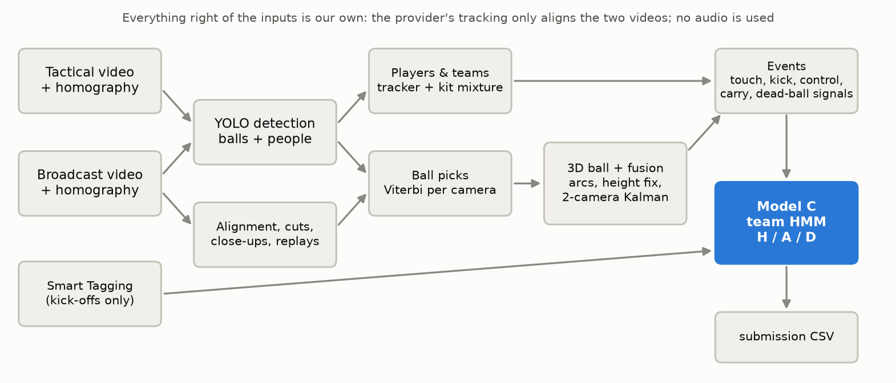
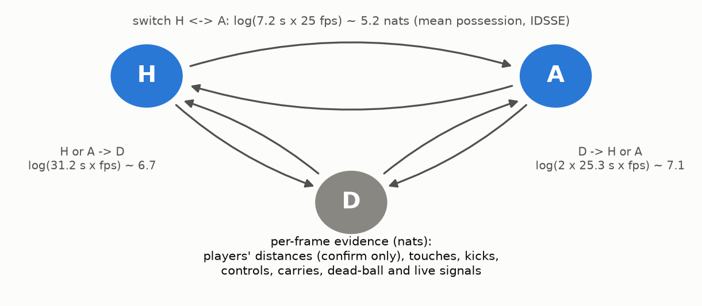
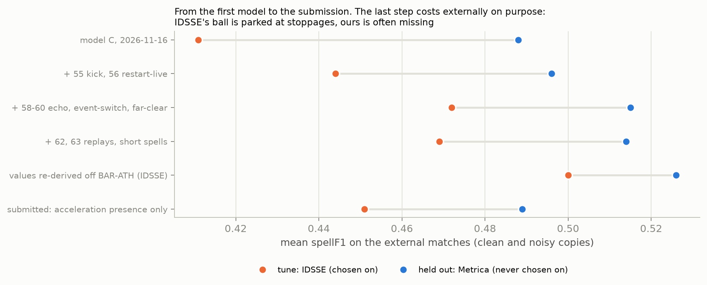

# Who has the ball: possession from our own detections and a team HMM

**Team:** gremio · **Members:** Matias Prates · **Repository:** https://github.com/mtprates/gremio-mtah27
**Submission file:** `gremio.csv`, from `python reproduce.py --team gremio`

## Summary

We label every frame of BAR-ATH as home (H), away (A) or dead ball (D) in two stages:

1. **Perception.** We find the ball and the players ourselves, in both videos.
2. **Inference.** A three-state hidden Markov model weighs everything the ball and players say
   about possession.

The provided tracking is used only to put the two videos on one timeline.

Two things shaped the design:

- **Ball errors become fake possession changes.** A jump between two ball-like objects reads
  as a kick, and a kick near an opponent reads as a turnover. Most of our work went into a ball
  track that cannot do what a ball cannot do.
- **The ranking metric counts possessions, not frames.** spellF1 punishes fragmenting one
  possession into several far more than it punishes a few late frames. So the decoder needs
  more than one touch before it hands possession over.

Nothing was hand-labelled on BAR-ATH, nothing was trained on it, and no value was chosen by
searching scores on it. Section 6 says exactly how every value was set, including the ones
that rest on observations of this match.



*The pipeline. Everything after the inputs is ours; the provider's tracking only aligns the two videos, and no audio is used.*

## 1. Approach, and why this one

**Why our own detections rather than the provided tracking.** The provided ball (ATD) was our
first input. We found that its errors look the same as the possession events we need to detect.
We also wanted a pipeline that would carry over to a match with only a broadcast camera. So we
detect balls and people ourselves, and treat the provider's ball and players as a point of
comparison, never as the truth.

**Why an HMM rather than rules.** Our first model was a state machine (rules R1 and V1 below).
On clean external tracking, R1 is the best decoder: every touch hands possession to the toucher's
team (Figure 3). On our noisy detector input it falls below the published floor: 0.284 spellF1 on
the public window, against 0.326 for `baseline_smooth50`. False touches split possessions apart.

The HMM (Figure 2) avoids this:

- Each frame gives evidence in nats, never a yes or no.
- Switching state has a price set from how long possessions and stoppages last.
- Viterbi finds the labels that explain the whole match at once.

As a result, one stray touch cannot flip possession unless other evidence agrees.



*Figure 2. Model C: three states and the prices of moving between them, from the mean lengths of possessions, live play and stoppages on IDSSE's labels.*

### Design choices, and why

**One touch is not enough to change possession.** An opposing touch is worth 3 nats against a
5.2-nat switch: possession changes on a kick, a control, a carry or a second touch. Two reasons:

- *Our tracking makes false touches.* A touch is a sudden change in the ball's velocity, and the
  jitter of a detected ball, or a jump from one ball-like object to another, looks exactly like
  one. Weighing a single touch less is the decoder's defence; the better cure is better
  tracking. We tried fine-tuning the ball detector on public images (it won there and lost on the
  tactical camera, section 1's table), and the tracking filters' weights are reasoned values, not
  tuned ones; both are where we would look next.
- *The challenge's definition.* CHALLENGE.md says a simple touch without control, a deflection
  that does not intercept a pass and an aerial duel won without control do not change
  possession. The cost is short possessions (section 7): the ground truth, derived mechanically
  from the provider's tracking, does contain some single-touch possessions.

**As independent of the provided data as we could make it.**

- *Our own tracking.* We detect and track the ball and the players ourselves. The provided
  tracking's errors (a ball jumping between objects, players swapping) look the same as the
  possession events we need to detect, and we had no ground truth to correct them against; so it
  is a point of comparison, never an input to the model.
- *Homography: not yet our own.* We use the provided per-frame homographies. Our own pitch
  calibration (PnLCalib) is built and agrees within ~0.4 m on a check clip, but is not wired in;
  doing so would make the pipeline independent of the provider apart from the alignment below.
- *Two cameras, kept separable.* Each camera has its own detections, ball picks and trace before
  the two are fused, and every broadcast-based rule (cut-aways, replays, rules 62-64) can be
  switched off. The external validation runs exactly that way, on a single camera stream with no
  broadcast at all. A broadcast-only version is therefore a matter of feeding that stream where
  the tactical camera is used now, which we have not tried. One dependency remains: the
  broadcast-to-tactical alignment matches player layouts using the provided tracking.
- *No audio.* The submitted model uses images only, so it would work on a broadcast with no
  sound or with commentary over the referee. A referee-whistle detector is built (rule 57), but
  it is not submitted, for that reason and because its thresholds were set on this match's
  whistles.

**Every graded frame gets H, A or D; no `X`.** The file writes `X` only on the 40,462 frames that
are never graded (before kick-off, half-time, after the final whistle). EVALUATION.md scores an
`X` two ways: macroF1 counts it as a miss, and spellF1 replaces it with the previous label before
matching possessions. So an abstention is free only inside a possession and costly at a change of
possession, where it carries the old team across the hand-over. Our decoder already does the
useful part: where the evidence is weak, the switch price keeps the previous label, which is
what spellF1 would do with an `X`. Abstaining on top would add nothing to spellF1 and cost
macroF1, and we have no reliable way to tell, in a weak stretch, whether a change is happening.

**Alternatives tried and dropped** (each value's basis in `docs/VALUES.md`):

| tried | outcome |
|---|---|
| Rules state machine on the provider's tracking (R1, V1) | Replaced by the HMM. R1 fragments on noisy input. |
| Model T: possession changes only at touches, won by pitch control (Spearman) | Too sticky: two opposing touches were needed to switch. Kept as a viewer comparison. |
| Model P: player-level HMM (a pass to a teammate is cheaper than a turnover) | Called 5% more of the match dead than C. Not submitted. |
| Ball detector fine-tuned on a public Roboflow set (CC BY 4.0) | Better on its own test set (AP 0.92 vs 0.64), worse on the tactical camera: static balls off the pitch, a domain gap. COCO weights kept. |
| Our own pitch calibration (PnLCalib) | Within ~0.4 m of the provided homography on a check clip. A full run takes ~24 h, so it is not wired in. |
| Referee whistles from the audio | Built. Rule 57 (a stoppage starts at the whistle just before it) is not submitted: five of the detector's values were set against this match's whistles, and no open dataset with audio exists to set them elsewhere. |
| Rules 28, 32, 37, 38, 40, 49-52, 54 (ball-track and touch variants) | Behind switches in the code, off. Rule 52 (pricing picks by precision in the tracker) backfired. |
| Rule 61: a kick from rest is no restart if the ball is back at rest soon after | Cost 0.001-0.004 on IDSSE at every window; off. Rule 63 handles the same false restarts by their length instead. |

## 2. Assets used

| asset | how we use it |
|---|---|
| Tactical and broadcast video | YOLO detection of balls and people in both. Shirt colours from the person boxes. |
| Provided homographies | Image to pitch, per frame, for both cameras. |
| Provided tracking (ATD) | Only to align the broadcast to the tactical timeline (`align.py`, by matching player layouts), and as a diagnostic yardstick. Never as model input for C. |
| Smart Tagging | The kick-off frames only (the FAQ allows it). |
| Public 5-minute ground truth | A pipeline check, plus three measured dead-ball signal weights (section 6). |
| COCO-pretrained `yolo11m` (Ultralytics) | Ball and person detector, no fine-tuning. |
| IDSSE / DFL open tracking, 7 matches (Bassek et al. 2025, CC BY 4.0) | External validation and the tuning set. |
| Metrica Sports sample games, 3 matches | Held-out external validation. Labels derived from their events by `model/metrica_sample_gt.py`. |

No hand labels exist anywhere in the project. The external labels are the providers' own.

## 3. The model

### 3.1 Two cameras on one timeline

`align.py` finds the broadcast-to-tactical frame offset per half from the layout of players, and
detects replays as jumps back in time. `shots.py` and `cameras.py` find cuts and close-ups from
image changes and from the height of people's boxes under the homography. Only the broadcast's
live wide shots are used. A broadcast shot whose homography contradicts the tactical camera is
dropped (rule 41).

### 3.2 Players and teams

- YOLO person boxes are projected to the pitch and tracked (`teams.py`).
- Shirt colours (torso pixels, with the grass removed) are clustered by a seeded Gaussian
  mixture into home, away, two keepers and officials. This runs unsupervised on the match at
  inference time: no labels, nothing trained.
- Short detection gaps are relinked (`detector_model.py`).

### 3.3 The ball

**1. Picks per camera** (`ball_track.py`). A Viterbi search runs over each camera's candidates,
and the cheapest path wins.

Cheaper:
- confident candidates;
- candidates the other camera supports (rule 29).

Dearer:
- standing still, the penalty spot, the advertising boards;
- moving faster than a ball can.

Rule 45 adds what a ball cannot do:
- reappear farther away than it could have travelled since it was last seen;
- turn up at a player's feet with no pass toward him;
- restart anywhere other than where the Laws put it;
- exist for a single isolated frame.

**2. Height** (`ball3d.py`, Figure 1). Each camera reports where its line of sight meets the
grass, which for a ball in the air is past the ball.

- Where both cameras see it, triangulation gives the height.
- Flights are fitted as whole arcs, with gravity and quadratic drag (rule 34, physical constants).
  Rule 47 also fits flights that only one camera sees.
- Each camera's point is then corrected to its height.

**3. Fusion** (`kalman.py`). A two-camera Kalman smoother runs forward and backward. It weights
picks by confidence and restarts only on evidence: both cameras agree, a kick, or a consistent
run. It bridges gaps, but never at a pace above 35 m/s, about the hardest shot (rules 39, 48).
A ball caught by a keeper stays with him until released (rules 36, 48).


*Figure 1. A camera sees where its line of sight to the ball meets the grass: for a ball in the air, a point well past it. Two cameras, or a fitted flight, give the height.*

### 3.4 Events

From the fused ball and our detected players (`rules.py`):

- **Touch:** a velocity change above 3.5 m/s, with a
  player within 2 m (a "far touch" up to 4 m, worth less), and not above head height. Touches
  closer than 6 frames are one touch. Where the ball is unseen for a few frames, the smoother
  places at most one touch inside the gap; if a stronger velocity change was measured just
  beside the gap, that measured one is the touch and the fitted one is dropped (rule 58).
- **Control:** the same team within 1.3 m of the ball for 0.4 s.
- **Carry:** a player who keeps his pace through a gap in which the ball is unseen.
- **Bounce:** the landing of a fitted arc with no horizontal change. It is not a touch.

### 3.5 The decoder: model C

Three states, H, A and D. Per frame, in nats:

- **Distance evidence:** the players' distances to the ball, counted once per 0.5 s of
  correlated frames and capped per frame.
- **Event evidence:** bonuses for the credited team at each touch, control and carry. A touch is
  3 nats, a far touch 1.5, a control or carry 4.
- **Dead-ball evidence:** each signal weighted by its reliability:
  - the ball out of bounds (graded: longer is surer, rule 27; 3 nats per 0.5 s, 6 once out for 1 s);
  - the broadcast losing its homography (a cut-away): 2.0 nats present, −1.3 absent, by reasoning
    (a director cuts away for most of a stoppage and little of live play; no open dataset has a
    broadcast to measure it on);
  - players standing still, and overall stillness: precision and recall measured on IDSSE's labels;
  - the ball's acceleration near zero: its presence counts (weight from IDSSE), its absence does
    not. On IDSSE a dead ball is parked and visibly still, so "not still" means live there; our
    ball is missing on many frames (44% unseen) and at a stoppage is mostly unseen or moving, so
    its absence is not a valid signal on our input.
- **A still ball during a cut-away (rule 64):** where the broadcast has cut away and the ball is
  still (over 3 s, the median speed of the frames it is seen on under 1 m/s, seen on at least a
  third of them), 3 nats per 0.5 s, as sure as the ball out of bounds. A still ball alone is no
  evidence: a player can hold a live ball at his feet. The cut-away alone is weak; together they
  are a stoppage.
- **Kicks (rule 55):** a touch is a kick when all of these hold:
  - the player is within 2 m;
  - the ball is seen on both sides of the touch;
  - the ball is on the ground and did not arrive in a flight;
  - it leaves at 8 m/s or more, no slower than it came, and away from the player.

  A kick is worth the switch price plus 1 nat, so on confident detections it hands possession to
  the kicker's team on its own (rule 53 scales it down on weak ones). A pass, shot or clearance struck by a player is an act of control. The 8 m/s cut is
  above a dribbling push and in the range of a short pass.
- **Detection precision (rules 53, 53b):** every event's nats are multiplied by how sure the
  ball detections around it are: the precision of the weaker side's nearest pick, measured by
  confidence band on public images (Roboflow, CC BY 4.0), over the top band's, at most 1. Below
  0.25 confidence a detection is the ball less than a third of the time, so a touch, kick,
  control or carry resting on such picks counts for little, instead of being cut at a
  confidence floor.
- **Possession changes only at an event (rule 59):** the distance evidence may only confirm the
  team credited with the latest touch, kick, control or carry, never flip it. A ball rolling past
  the other team's players stays with the team that last played it.
- **Far touches need a clear nearest team (rule 60):** a far touch (2-4 m) counts only when the
  other team's nearest player is at least 1 m farther from the ball; nearer than that, our
  position errors cannot tell who touched it.
- **Live evidence (rule 56):** a restart (a ball kicked from rest inside the pitch), or any
  kick, gives 9 nats against dead ball, spread over the next second.
- **Replays are neutral (rule 62):** a broadcast replay shows earlier play, so on replay frames the
  broadcast gives no evidence either way. Before, a replay's homography read as "the broadcast is
  not cut away", which counted as live evidence during a stoppage.
- **Transitions:** prices from mean lengths measured on IDSSE's labels:
  - H ↔ A: log(7.2 s × 25) ≈ 5.2 nats (mean possession 7.2 s);
  - live → dead: from a 31.2 s mean live stretch;
  - dead → live: from a 25.3 s mean stoppage.
- The second half is forced dead before its kick-off.

Viterbi gives the labels, and forward-backward a per-frame confidence for the viewer. One pass
then cleans up short spells (rule 63), in this order:

1. A live spell shorter than 5 s between two stoppages becomes dead, unless the ball leaves the
   pitch within 1 s of its end. Inside a stoppage the ball is often moved (passed back to the
   keeper, to the taker) and a touch reads as a restart; real play that short almost always ends
   with the ball going out.
2. A stoppage shorter than 5 s between two spells of the same team becomes that team's, when the
   broadcast's close-up is its only dead-ball evidence: the broadcast alone does not overrule a
   tactical camera that shows play going on.

The window is 5 s, a round value set by reasoning, not tuned. Spot checks on BAR-ATH found both
patterns; on the external matches the window makes little difference (4, 5 and 6 s differ by
under 0.002 on IDSSE), and the rule's targets, false restarts inside a stoppage and broadcast
cut-aways, are artefacts of our own input that the external data does not have. The
submitted file writes `X` only on the 40,462 ungraded frames (before kick-off, half-time, after
the final whistle). Every graded frame gets H, A or D.

## 4. The possession rules we implemented

CHALLENGE.md defines a change of possession as an opponent gaining **controlled** possession.
Where we drew the line:

| situation | our rule |
|---|---|
| **A single touch** by the other team | Not enough by itself: 3 nats against a 5.2-nat switch. It needs one more touch, a control or a carry, or the distance evidence. This follows CHALLENGE.md's "a simple touch without control" does not change possession. |
| **A kick** by the other team (rule 55): a ground ball sent off at 8 m/s or more, faster than it came, away from the player | Changes possession on its own: an interception struck straight on is control, even with no dwell. A deflection fails the "faster than it came" test. |
| **A deflection** (the ball keeps its course) | No velocity change above 3.5 m/s, so no touch. |
| **A header or aerial duel** | A touch in the air is weak (rule 26, `air_touch`). Possession follows whoever controls the ball afterwards. |
| **A loose or contested ball** | Possession changes only at an event (rule 59): the players' distances cannot hand a loose ball to the nearer team, so the previous possessor keeps it until the other side touches, kicks, controls or carries it. A far touch between two equally near opponents counts for nobody (rule 60). |
| **A challenge (tackle)** | A tackle that wins the ball shows up as the tackler's team's control or carry. One that only knocks it loose stays with the previous team, as above. |
| **A ball out of bounds** | Dead from the moment it crosses the line, by more than 0.5 m for 3 frames, until the restart. |
| **A stoppage** (foul, injury) | Dead when the players are mostly still or the broadcast cuts away, and surely so when the ball lies still while the broadcast has cut away (rule 64). A cut-away under 5 s inside one team's possession, with nothing on the tactical camera to support it, is not a stoppage (rule 63). Replays say nothing either way (rule 62). |
| **A restart** | Live from the restart touch (rule 56 adds live evidence there). A "restart" followed by a stoppage within 5 s, with no ball going out, was the ball being set up, not play (rule 63). The team taking it gets the touch evidence, so the restarting team has the ball (CHALLENGE.md: "a clear possessor"). |
| **A goalkeeper's catch** | The keeper holds the ball until release (rules 36, 48): his team's possession, with no phantom touches during the hold. |
| **Before kick-off / half-time** | Forced dead, from the Smart Tagging kick-offs. |

## 5. Results

**Public window** (17 possessions, a pipeline check only):

| model C with rules | external tune / holdout spellF1 | public spellF1 (possessions) | public macroF1 | possessions, whole match |
|---|---|---|---|---|
| none (C as of 2026-11-16) | 0.411 / 0.488 | 0.637 (10) | 0.898 | 245 |
| 55, 56 | 0.444 / 0.496 | 0.613 (13) | 0.893 | 263 |
| 53, 53b, 55, 56 | as above (no confidences externally) | 0.614 (11) | 0.895 | 243 |
| 53, 53b, 55, 56, 58, 59, 60 | 0.472 / 0.515 | 0.627 (13) | 0.881 | 233 |
| 53, 53b, 55, 56, 58-60, 62, 63 | 0.469 / 0.514 | 0.648 (12) | 0.893 | 224 |
| **the same, values re-derived off BAR-ATH, + rule 64 (submitted, `b581e17`)** | **0.451 / 0.489** | **0.634 (12)** * | **0.894** * | **224** |

\* Scored once on the frozen model before its last two changes (`79152f5`): rule 63's window
restored from 4 s to 5 s, and rule 64, which changes one 2.7 s stretch of the match. The window
was not scored again. For scale on the same window: the published floor `baseline_smooth50`
scores 0.326 (bootstrap interval 0.21-0.45, ours 0.43-0.80), and the ground truth itself delayed
by 0.5 s, 1 s and 2 s scores 0.906, 0.776 and 0.588. The submission scores like a perfect labeller
running about 1.5 s late.

EVALUATION.md is explicit that one possession here moves spellF1 by about six points. The rows
above were scored as checks; no value was chosen by them. The window was looked at once more,
on the re-derived values before the acceleration change below (spellF1 0.640 against 0.648):
no significant change, and nothing was decided by it.

**External matches.** The decoder runs on clean optical tracking from 10 public matches
(Figure 3; `validation/README.md`):

- **The HMM:** best macroF1 in 10 of 10 games, and best alive/dead F1 with no broadcast at all.
- **R1:** best spellF1 on clean data, where every touch is real.

The HMM's deficit is almost entirely in possessions shorter than 4 s (Figure 4). A fixed switch
price implies a geometric spell length, so a 2-second spell pays the price twice (see the
limitations: partly by design).


*Figure 3. The submitted model on the 10 external matches (clean tracking), against R1, our model of 2026-11-16, and the ground truth delayed by 1 s for scale.*


*Figure 4. Share of true possessions found, by their length. Long possessions are found about as often as by R1; short ones much less, partly by design (section 7).*

**External tuning stage** (`model/tune_external.py`):

- **Search:** run on the 7 IDSSE matches, each clean and with noise that mimics our detector's
  ball dropouts.
- **Holdout:** Metrica, scored once per candidate and never used to choose.
- **Outcome:** no default changed. The best IDSSE values gained only +0.007 on Metrica and
  fragmented model C on the public check.

Rules 55 and 56 were the first changes to beat the current defaults on both sets: tune 0.411 → 0.444,
holdout 0.488 → 0.496 (`KICK_MARGIN` 1 and `LIVE_KICK_LLR` 9, chosen on IDSSE). Rule 59 (possession
changes only at an event) was the largest single gain after them: 0.471 / 0.514, recovering most of
the team accuracy that rules 55 and 56 cost. With rule 58: 0.472 / 0.518; rule 60 is neutral on the
copies (0.472 / 0.515), which lack the false far touches it removes. Rules 53 and 53b cannot be
scored externally: the copies have no detector confidences.

**Re-derivation off BAR-ATH.** Every value of the submitted path that had rested on the public
window or on BAR-ATH scores was then set again from outside it, judged on IDSSE and reported on
Metrica: the mean possession, live and dead lengths and the dead share from IDSSE's labels, the
dead-ball signals' precision and recall measured there, the broadcast signal by reasoning
(section 6). That took the external scores from 0.469 / 0.514 to 0.500 / 0.526. One measured value
did not transfer: IDSSE's ball is parked at stoppages, so there "the ball is not still" is strong
evidence of live play; ours is missing on many frames and moving at most stoppages, and spot
checks found stoppages missed for that reason. Counting only the presence of a still ball costs
0.047 / 0.035 externally, because there the absence is real, but it is the reading that fits our
input. With rule 63's 5 s window: **0.451 / 0.489** (rule 64 cannot fire on the external matches:
they have no broadcast). Against the model of 2026-11-16 (0.411 / 0.488), and per set:

| frozen model, external | spellF1 | delayed truth for scale (1 s / 2 s late) | possessions vs truth |
|---|---|---|---|
| IDSSE, clean | 0.486 | 0.557 / 0.356 | ×0.59 |
| IDSSE, noisy | 0.417 | | ×0.48 |
| Metrica, clean | 0.543 | 0.608 / 0.426 | ×0.57 |
| Metrica, noisy | 0.435 | | ×0.48 |

(`validation/readiness_sets.csv`, written by `model/readiness.py`; rule 64 cannot fire on the
external matches, which have no broadcast.) On clean tracking the submitted model scores like a
perfect labeller running about 1.2 s late, and on the public window like one about 1.5 s late:
the two datasets agree, which we take as a sign the model is not fitted to BAR-ATH. It finds
about 80% of possessions longer than 8 s and is robust to noise (on the noisy copies it is level
with R1, which collapses on our own detector input); it predicts about half as many possessions
as there are, almost all of the missing ones short (Figure 4, section 7).



*Figure 5. External spellF1 at each stage, chosen on IDSSE and reported on Metrica. The last step is a deliberate cost: on IDSSE a dead ball is parked and visibly still; ours is often unseen.*

## 6. How every value was set

Every constant had a dated rationale entry in our development log, written before the code: its
value, its reason, the alternatives, and how to revisit it. `docs/VALUES.md` lists every value with
its basis. Values fall into four groups:

| group | examples | basis |
|---|---|---|
| **Physics, the Laws of the Game, published figures** | 35 m/s maximum ball pace, drag coefficient, penalty-area size, the restart tests | external |
| **Measured or chosen on external matches** | the mean possession, live and dead lengths and the dead share (IDSSE's labels); the dead-ball signals' precision and recall (IDSSE); the HMM weights left at their values by the IDSSE search; `KICK_MARGIN`, `LIVE_KICK_LLR` (rules 55-56); `ref_delay` 0 and rule 27's out-of-bounds values confirmed there; rules 58-60 tested there | external (IDSSE, Metrica held out) |
| **Reasoned** | the broadcast cut-away signal (no open dataset has a broadcast); the player relink window and view margin; the keeper's hold; rule 63's 5 s window and rule 64 (checked on IDSSE where they can fire) | reasoning, a physical limit or the Laws |
| **Adopted after spot checks on BAR-ATH** | rules 53 / 53b (Matias checked the spells they change in the viewer); the choice of rules 58-60 (a kick lost to a ball-gap artefact and a loose ball); rules 62-64 (replays, short spells, a still ball in a cut-away); counting only the presence of "ball acceleration near zero" (stoppages missed on our input). Their values are external or reasoned; which rules to submit was decided with these checks. One of them (rule 64) came from a moment inside the public window | external or reasoned values, BAR-ATH check |
| **Reasoned heuristics, motivated by a failure seen on BAR-ATH** | most ball-track switches (rules 29-48): e.g. a junk pick 30 m away that the tracker took. The values are physical or reused round numbers ("initial guess, untested"), never swept to a score. | heuristic, BAR-ATH case |
| **Own measurement** | the noise floors of our own detections, set once without labels or scores: the touch threshold (3.5 m/s velocity change), "acceleration near zero" (3 m/s²) and the still-player speed (0.9 m/s) | BAR-ATH, disclosed |

No value in the submitted model is trained, fitted, or chosen by a score on BAR-ATH. The full list,
with each value's basis, is in `docs/VALUES.md`.

## 7. Limitations, and what we would do next

- **Short possessions, partly by design.** CHALLENGE.md says a simple touch without control, a
  deflection that does not intercept a pass, and an aerial duel won without control do not change
  possession. We follow it: one uncontrolled touch is worth less than a switch, and possession
  changes on a kick, a control, a carry or a second touch. The ground truth, derived mechanically
  from the provider's tracking, does contain very short possessions, some of them single touches:
  2 of the 17 public possessions last under 2 s (0.8 s and 1.3 s), and 6 under 4 s; on the external
  matches 25-37% of true possessions last under 2 s. We find 5-11% of those under 2 s on the
  external matches (Figure 4), so part of this gap is a deliberate reading of the rules rather than
  a tracking error. The rest is a real limitation: of possessions of 2-4 s we find 11-23%, where
  the touch-by-touch rule R1 finds 26-49% (on clean data, where every touch is real). Next: a
  duration-aware decoder (HSMM), or a switch price that falls where the ball is seen cleanly.
- **False touches.** Jumps between ball candidates and team-label flips are BAR-ATH's main
  noise, and our external noise model does not include them yet. Adding them comes before any
  new search.
- **Live/dead boundary.** Our stoppage signals (still players) arrive a few seconds after the
  whistle. Rule 57 moves a stoppage back to a broadcast whistle (12 stoppages, 2.9 s median,
  public macroF1 0.898 → 0.922), but it is not submitted: the whistle detector's thresholds were
  set on this match's whistles.
- **Short spells.** Rule 63 removes live spells under 5 s between stoppages and fills short
  broadcast-only stoppages. Real play that short (a corner cleared at once before the next
  stoppage) can be lost, and a false restart longer than 5 s is not caught. A test of where the
  ball comes to rest (the goal area, the corner arc) would separate a ball set up for a restart
  from one in play; a stillness-only version (rule 61) cost on the external matches.
- **A ball played around during a stoppage.** Kicked away, passed to the taker or juggled, it
  looks like live play to the tactical camera; only the broadcast and the referee's whistle show
  the stoppage, and we weigh the broadcast below clear tactical evidence. Rule 64 catches the
  part of such a stoppage where the ball lies still during a cut-away, not
  the part where it is kicked about. The whistle detector would catch these, but its thresholds
  were set on this match's whistles, so it is not submitted.
- **Tracking differs from the external data.** The external matches' provider parks the ball at
  stoppages and never loses it; our detector's ball is unseen on 44% of graded frames. Signals
  that depend on the ball at a stoppage transfer badly (the acceleration signal above), and our
  noise model for the external copies (ball dropouts, jitter) does not reproduce this.
- **Dead balls against keeper saves and stalling.** A stoppage, a keeper holding the ball after
  a save, and a player standing on the ball to slow the game look alike to our model: the ball
  is still or unseen, someone is near it, and play has paused. The difference is in how the
  players move (walking back into shape, lining up a wall, the keeper waiting for team-mates to
  push up) and in who exactly has the ball. A catch while the ball is unseen gives no event, so
  the attacking team keeps possession until the next one; a low-confidence pick near
  a keeper can end a stoppage early. Play close to a dead ball (a quick restart, a ball knocked
  about after a whistle) is error-prone for the same reason. Next: player movement patterns as
  evidence, and higher-resolution player labels (individual identities and roles, keepers in
  particular, rather than team and keeper groups), and extending the keeper hold (rules 36, 48)
  to a ball that disappears near a keeper.
- **Dependence on provided data.** The homographies and the video-to-video alignment are still
  the provider's. Our own calibration is built but not wired in.
- **The tactical camera's ball is small** (about 5 px). Detector recall at players' feet is the
  ceiling on everything above. Fine-tuning on a wide-angle dataset (SoccerTrack v2) is the lead.

## 8. Reproduction

```
git clone https://github.com/mtprates/gremio-mtah27 && cd gremio-mtah27
python -m venv .venv && .venv/Scripts/python -m pip install -r requirements-detect.txt   # torch for your GPU first
# lay out the match data as DATA.md describes (./data, or set MTAH_DATA_DIR)
.venv/Scripts/python reproduce.py --team gremio      # -> submission/gremio.csv, validated
```

`reproduce.py` runs every step whose output is missing:

| step | what it does | time (GTX 1660 Ti) |
|---|---|---|
| detection | YOLO over both videos | ~13 h |
| shot features, cuts | the broadcast's shots | ~10 min |
| tracker and teams | per video chunk | not stated |
| model | ball track, events and HMM | ~15 min first time |
| submit | copy and validate the file | seconds |

**Hardware and determinism.** The detections were produced on a GPU (NVIDIA GTX 1660 Ti, CUDA
12.6, torch 2.14.1+cu126, ultralytics 8.4.183). GPU inference is not bit-for-bit reproducible
across GPU models, drivers or CPU-only runs: box coordinates and confidences can differ in their
last digits, which near a decision threshold can change which ball candidate the tracker picks,
and so a few labels. Everything after detection is deterministic (the kit clustering is seeded),
and given the same detections the file is reproduced byte for byte: checked on a fresh clone of
the submitted commit, run against the same detections, which rebuilt `gremio.csv` identically
(224 possessions, validated). Small differences in a rerun from the videos are therefore
expected, and come from detection, not from the model.

`model/readiness.py` and `model/tune_external.py` rebuild the external results from the public
datasets (download steps in `external/README.md`).

Python 3.13. The tested versions are pinned in the requirements files. `docs/make_figures.py`
redraws these figures from committed files only.
